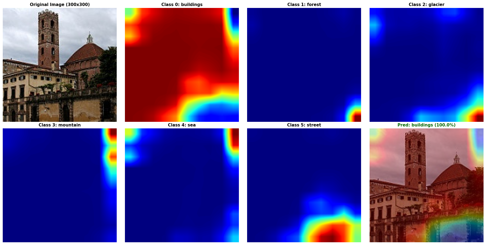

# 🏞️ Natural Scene Image Classification & Architectural Comparison (3-Layer vs. 4-Layer CNN)

A deep learning computer vision project that classifies natural scenes into six categories (`buildings`, `forest`, `glacier`, `mountain`, `sea`, `street`) using TensorFlow/Keras. This project conducts a controlled architectural comparison between a **3-Layer Lightweight CNN** and a **4-Layer Deep CNN**, complemented by **Spatial Class Activation Heatmaps** for model interpretability.

---

## 📊 Dataset Overview
The models are trained and evaluated on the **Intel Image Classification Dataset** (~25,000 RGB images resized to `150×150×3` across 6 balanced scene classes):
* **Training & Validation (`seg_train`):** 14,034 images (80% training / 20% validation split)
* **Testing (`seg_test`):** 3,000 images (held out for final evaluation)
* **Unlabeled Inference (`seg_pred`):** 7,301 images

| Class | Train Images | Test Images | Total |
| :--- | :---: | :---: | :---: |
| **Mountain** | 2,512 | 525 | 3,037 |
| **Glacier** | 2,404 | 553 | 2,957 |
| **Street** | 2,382 | 501 | 2,883 |
| **Sea** | 2,274 | 510 | 2,784 |
| **Forest** | 2,271 | 474 | 2,745 |
| **Buildings** | 2,191 | 437 | 2,628 |

---

## 🧠 Model Architectures & Hyperparameter Setup
Both models share an identical preprocessing pipeline (`RandomFlip("horizontal")`, `RandomRotation(0.1)`, and `Rescaling(1./255)`), using the **Adam** optimizer (`lr=0.001`), **Sparse Categorical Cross-Entropy** loss, and a batch size of **32**.

| Feature / Hyperparameter | Model 1: Deep CNN (`build_4layer_model`) | Model 2: Lightweight CNN (`build_3layer_model`) |
| :--- | :--- | :--- |
| **Convolutional Blocks** | **4 Blocks** (`32 → 64 → 128 → 256` filters, `3×3` kernels) | **3 Blocks** (`32 → 64 → 128` filters, `3×3` kernels) |
| **Final Feature Map Size** | `9 × 9 × 256` | `18 × 18 × 128` |
| **Dense Classification Head** | 128 Neurons (`ReLU`) | 64 Neurons (`ReLU`) |
| **Regularization (Dropout)** | `0.4` (40%) | `0.3` (30%) |
| **Output Layer** | 6 Neurons (`Softmax`) | 6 Neurons (`Softmax`) |

---

## 📈 Performance Comparison & Evaluation Results
Evaluated on the unseen **3,000-image test set**, the deeper 4-layer architecture outperformed the 3-layer baseline by **+4.0% in overall accuracy**, demonstrating stronger discrimination on complex urban and terrain textures.

| Metric (Test Set) | Model 1 (4-Layer CNN) | Model 2 (3-Layer CNN) |
| :--- | :---: | :---: |
| **Overall Test Accuracy** | **85.0%** | 81.0% |
| **Macro Avg Precision** | **0.85** | 0.82 |
| **Macro Avg Recall** | **0.85** | 0.82 |
| **Macro Avg F1-Score** | **0.85** | 0.81 |

### Per-Class F1-Score Breakdown
* **Forest:** `0.96` (4-Layer) vs. `0.96` (3-Layer) — Highest classification accuracy due to distinct green foliage textures.
* **Street:** `0.87` (4-Layer) vs. `0.84` (3-Layer)
* **Buildings:** `0.83` (4-Layer) vs. `0.76` (3-Layer) — Significant precision jump (`0.68 → 0.82`) with the 4th convolutional block.
* **Sea:** `0.83` (4-Layer) vs. `0.79` (3-Layer)
* **Glacier:** `0.80` (4-Layer) vs. `0.78` (3-Layer)
* **Mountain:** `0.79` (4-Layer) vs. `0.76` (3-Layer)

### Visual Diagnostics
* **Training & Generalization:** Data augmentation and dropout (`0.3` / `0.4`) successfully prevented overfitting, keeping training and validation loss closely aligned throughout training.
* **Confusion Matrix Insights:** Primary misclassifications occurred between visually overlapping classes—specifically **Mountain vs. Glacier** (shared snow/rock textures) and **Buildings vs. Street** (urban structural overlap).

.png)

---

## 🔥 Model Interpretability (Spatial Activation Heatmaps)
To verify that the network learns meaningful semantic regions rather than background noise, a fully convolutional inference pass was performed on high-resolution (`300×300`) test images to extract `(19, 19, 6)` spatial activation maps. The resulting class activation heatmaps confirm that the model accurately localizes architectural structures (e.g., achieving **99.97% confidence** on `buildings`).

---

## 🛠️ Tech Stack & Future Improvements
* **Frameworks & Libraries:** TensorFlow, Keras, NumPy, Pandas, Matplotlib, Seaborn, OpenCV
* **Planned Enhancements:**
  * Integrate `BatchNormalization()` layers after convolutions to accelerate convergence and stabilize gradients.
  * Apply `ReduceLROnPlateau` learning rate scheduling to refine fine-grained separation between `mountain` and `glacier` classes.

---

